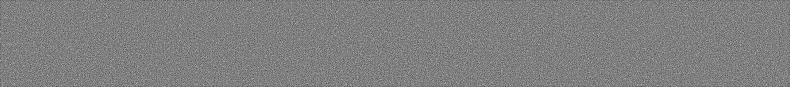
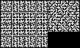
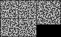
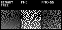
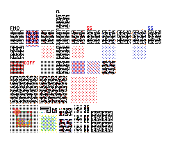

# Maze-Gen
This repo serves as a final collection of all my projects maze related. I have worked on this project for multiple years, and I have decided to finally stop. I will leave all my data for someone else to push ahead further. The repo includes TeraMaze (world's biggest maze online at time of creating this) and my best algorithms and ideas for infinite maze generation. As well as the least bias algorithm I have been able to find for a locally deterministic (infinite or finite) perfect maze and a brilliant hashing algorithm for infinite noise from streamed coordinates. Enjoy!

Project status: Archived

Contents: 
• TeraMaze – one of the largest online perfect mazes 
• FNC – local deterministic (infinite/finite) maze algorithm 
• Spin Scramble (SS) – bias reduction and maze scrambling while preserving perfectness 
• Maze Weaving – weaving algorithm for deterministic mazes 
• Infinite Noise – streamed-coordinate hashing technique 

Development: 2024–2026

## TeraMaze
The final TeraMaze attempt can be found here: https://gigapan.com/gigapans/238145 on Gigapan as one of the largest images the website hosts. It is what I believe to be the world's largest computer generated perfect maze on the internet. On the page you can find some more details on it as well as the issues I left it with. 

### The Issue
I will recap the issue here. The maze is generated in chunks, to avoid VRAM and allow the project to run without terabytes of RAM. The first chunk generates like a normal growing tree maze. The chunk stitching should be simple - the chunks themselves are generated connected like a mini maze (via more growing tree), any new chunk checks if any chunks around it have been generated yet (of which it must be touching at least one old chunk) and any edges of the chunk that were touching old chunks can have new maze generated from - the edges of the maze become a line of origin points for binary tree. This would create a seamless final maze. The issue was that the code wasn't recognising some of the available walls to grow from, creating giant seams stretching across the maze, this could definitely have been due to the maze prioritising growing from new maze structure rather than the wall origin. One its own, the chunk is not a perfect maze, but when stitched with the other chunks, it works very well.

### Other optimisations:
. Swapping the random library to std::pcg64 with thread local storage for parallelisation and uint64_t to prevent integer overflow when selecting next maze cell 
. Further utilisation of queues and stacks 
. Turn off PNG compression for temp files when there is space on device 

By fixing these issues, adding the optimisations and generating a final maze, you would possibly be able to hold the record for world's biggest maze!
I believe I have included the final code in c++ (called Maze_Optimised_300000_Uniform.cpp) in a zip folder also containing the rest of the files I used for testing (files too large such as big mazes were removed). The vips-dev-8.17 folder has been left empty, you will need to download dependencies and reroute file paths if you want to use this direct code. For this reason, the code has not been included as a working prototype but mainly as a learning experience, for iteration and improvement.

## InfiniMaze
Despite there being a lot of test code and working prototypes, I will only include the algorithms I created and core ideas for the project, as to provide a clean slate for anyone wanting to begin.

### FNC:
Flow Noise Construction is a very simple algorithm, it is built as a local, deterministic improvement of binary tree algorithm. Think of it as a ternary tree algorithm. It is an improved version of binary tree that allows you to travel in three directions, whilst still being perfect, very simple, and local.
It works like this: 
    First we initialise a grid with deterministic floating point noise (for infinite deterministic mazes), each cell then goes through this process: 
        1) If this cell is the highest of it, the left cell and the right cell, connect up. 
        2) Else, connect to the lowest higher cell (left or right). 
    If needed for finite mazes, the rules can be simplified to, "every cell connect left or right, for any cells connecting to each other, one connects up" 
Very simple, but very effective for anyone wanting a better binary tree.

A python demonstration is included.

### SS:
Spin scramble is simply this: 
Every rotation of cells in a small C shape (4 cells, 3 connections), can be rotated around its centre as long as it doesn't rotate cells already being rotated in another viable C shape. So parallel processing is allowed and recommended, but ensure there are no conflicts.
This can be done with wall Cs or path Cs. 
It MAINTAINS MAZE PERFECTNESS - no new loops or islands are created. 
If an unbiased perfect pattern was discovered with loads of Cs, putting it through SS would make an extremely efficient, perfect, visually unbiased infinite / finite deterministic maze.

A python program is included that fits with FNC to scramble mazes. (To-be-scrambled maze must be in the same dir as "maze.png")

SS Scrambling, Before: 
 
After: 
 

Binary Tree VS FNC VS FNC + SS: 
 

Image showing SS process in multiple passes including various amounts of rotation clockwise (1, 2, 3, Rand) and wall and path SS (TOP), SS conflict-avoiding parrallelisation patterns (MIDDLE), effective locality over multiple SS passes (BOTTOM), SS difference map (DIFF), and effectivity tests (BOTTOM RIGHT) on no BG: 
 

### Maze weaving algorithm:
This one is quite a bit more complicated. 
It Goes as such: 
First choose an orientation (vertical or horizontal), then choose a bias fallback direction perpendicular to the orientation (eg. vertical and left, horizontal and up). In this run-through, I will choose horizontal and down. First we initialise all horizontal rows we care about (in the viewport) with either 0 or 1 (left or right), we can do this using deterministic hashed noise for infinite deterministic mazes (below). This creates loads of horizontal lines pointing either left or right. Then between each row, we add vertical connections randomly (again, hashed noise for infinite mazes), if the connections are between two rows that go in the same direction (both 0 or both 1), then the connection can be up or down (choose randomly, deterministically for infinite mazes (eg. using hashed noise)). If between different rows, it can only be in our bias fallback direction, in this case, down. Finally, since one cell in a perfect maze can only have one OUTGOING connection, any cells that connect outwards (point to another cell, being pointed to does not count) horizontally and vertically, break their horizontal connections.
 

 
The final result is multiple FNC-style mazes with various bias directions joined together, it removes any small scale and most large scale bias. Passing it through SS afterwards creates the least bias algorithm that I can find for a locally deterministic perfect maze.

### Infinite noise:
FNC and the Maze weaving algorithm both base themselves off a grid of random float values to make it entirely deterministic and local for infinite mazes where parts of the maze do not change upon return. 
I have found the best way to generate MASSIVE random noise is to do as follows: 
Stream the coordinates from the user for x and y as strings (one after the other usually). 
*Optional:{Have 3 running coords strings for x and y, one coord is the direct input of the user, the other two are the direct inputs +1 and -1 (this is very easy to automate with cascading wraparounds and string editing)} 
The most recent x digits input from the user are held in a separate variable and NOT streamed to the strings yet. 

Whenever these two strings get too big, update their respective sha512 hash with their value and set the string back to "" ready to be filled again. Sha512 hash can be updated in a way that a value passed in all at once has the same result as half the value being passed in then the other half of the value updating the hash.

When the user finishes their x and y coord inputs, you can iterate through all possible values of the last x digits not yet streamed and update the x and y hash with them. Finally combine the output values of the x and y hash into a final sha512 hash, with a delimiter (:) and signs (positive +, or negative -) or use any other way of combining the values. *If using 3 running coords for x and y, then also iterate through those with all possible last x digits - this is especially useful if the user enters 999...999 where normally with the last 2 digits separate, they would be restricted from accessing 1000...000, but this solves that.

This creates a surrounding viewport of a massive noise space around the input coord for the algorithms continuously streamed from the user, so the full coords do not need to be remembered. VERY Powerful if the coordinates are MASSIVE and would take up more space than the resulting viewport.

Alternatively, you could just pass the entire coordinates, their signs and a delimiter through the Sha512 hash at once.

## Significance
TeraMaze demonstrates how the use of chunked generation can scale maze generation to extremes, to show that the true boundaries for maze generation are far beyond even the boundaries for image generation. I intend the code and related parts to be used as inspiration to push maze generation even further, rather than as a simple program to run. That is why I have preserved it rather than making it run universally and dependence-free.

Binary tree mazes exhibit strong directional bias, since each maze cell only has 2 directions to choose from, FNC aims to solve that issue, by pushing it to three, reducing structural and visible bias whilst preserving the locality, determinism and perfectness of binary tree. SS and Maze weaving squeeze the concept even further, in my experience a less bias algorithm of this type is very difficult to produce without adding insane algorithmic complexity or non-locality.

Development ended in August 2026... The repository is now for the preservation of the project for future learning and experimentation.
